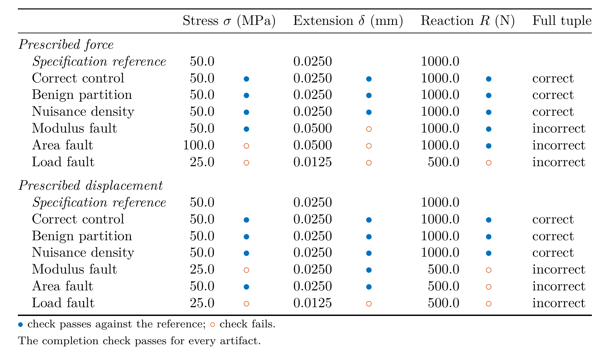
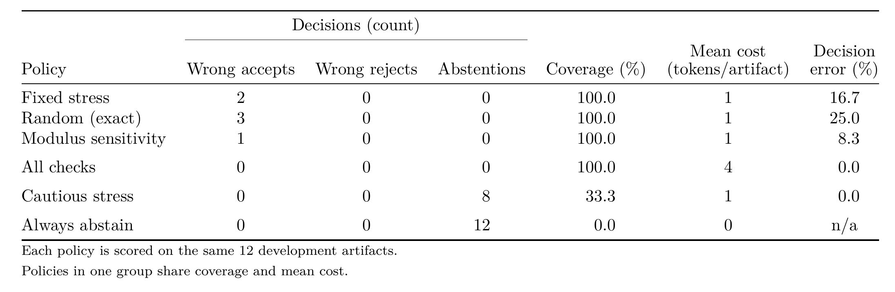
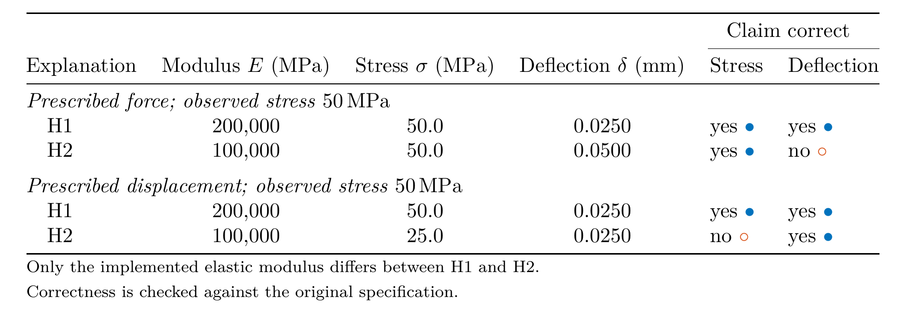
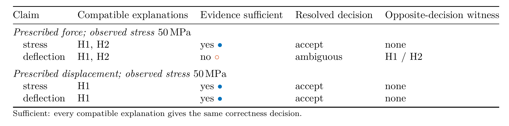

# Results, data and figure index

The sole active development plan is [ROADMAP.md](../ROADMAP.md). The result
below is completed development evidence; future claim-specific benchmark gates
are recorded in that roadmap.

## Current evidence-sufficiency result

| Artifact | Meaning | Reproduction |
| --- | --- | --- |
| [Specification](../studies/evidence_sufficiency/spec.json) | Single home for dimensions, loading, perturbations, comparison tolerances and acquisition costs | Inputs to the runner |
| [Numeric result](../reports/evidence-sufficiency/results.json) | Full development outcome matrix, truth, source hashes, policy and per-configuration scores | `python -m studies.evidence_sufficiency.run` |
| [Tables](../reports/evidence-sufficiency/matrix.md), [outcome CSV](../reports/evidence-sufficiency/outcomes.csv), [policy CSV](../reports/evidence-sufficiency/policies.csv) | Values and checks separated by loading, followed by counts and coverage/cost; CSVs retain full precision | Same command |
| [PNG](../reports/evidence-sufficiency/boundary-condition.png), [PDF](../reports/evidence-sufficiency/boundary-condition.pdf), [SVG](../reports/evidence-sufficiency/boundary-condition.svg), [plotted values](../reports/evidence-sufficiency/boundary-condition-data.csv), [caption](../reports/evidence-sufficiency/boundary-condition.caption.md) | Control and half-modulus stress [MPa], extension [mm] and reaction [N]; marker fill shows each observable check outcome, the caption carries the words | `python -m studies.evidence_sufficiency.plot`, then `matlab -batch "addpath matlab; render_figures"` ([MATLAB notes](../matlab/README.md)) |
| [Outcome table](../reports/evidence-sufficiency/outcomes-table.png), [policy table](../reports/evidence-sufficiency/policies-table.png) (PDF and LaTeX source beside each) | Typeset views of the matrix tables below | Same MATLAB command, then `python matlab/typeset_tables.py` |
| [FEA table](../reports/fea-interpretation.md), [numeric interpretation](../reports/fea-interpretation.json) | Completion, correlation agreement and convergence separated, with original record hashes | `python -m cadloop.fea.interpret` |

The figure is a verification example, not physical validation. Configuration
and source provenance are linked above; no decorative or generated artwork is
used. The table and figure derive their numbers from the executed matrix.
[Protocol and derivation](../studies/evidence_sufficiency/README.md) explain the
independent reference and what selectors can observe.

### Typeset result tables

MATLAB writes these tables from [results.json](../reports/evidence-sufficiency/results.json)
and [policies.csv](../reports/evidence-sufficiency/policies.csv). A blue dot means the check
passes against the specification reference; an orange open dot means it fails.



<details><summary>Table as text</summary>

**Prescribed force: artifact outputs**

| Artifact | Stress [MPa] | Extension [mm] | Reaction [N] | Full tuple |
| :--- | ---: | ---: | ---: | :--- |
| Correct control | 50.0 | 0.0250 | 1000.0 | Correct |
| Benign partition | 50.0 | 0.0250 | 1000.0 | Correct |
| Nuisance density | 50.0 | 0.0250 | 1000.0 | Correct |
| Modulus fault | 50.0 | 0.0500 | 1000.0 | Incorrect |
| Area fault | 100.0 | 0.0500 | 1000.0 | Incorrect |
| Load fault | 25.0 | 0.0125 | 500.0 | Incorrect |

**Prescribed force: executed checks**

| Artifact | Completion | Stress | Extension | Reaction |
| :--- | :---: | :---: | :---: | :---: |
| Correct control | PASS | PASS | PASS | PASS |
| Benign partition | PASS | PASS | PASS | PASS |
| Nuisance density | PASS | PASS | PASS | PASS |
| Modulus fault | PASS | PASS | **FAIL** | PASS |
| Area fault | PASS | **FAIL** | **FAIL** | PASS |
| Load fault | PASS | **FAIL** | **FAIL** | **FAIL** |

**Prescribed displacement: artifact outputs**

| Artifact | Stress [MPa] | Extension [mm] | Reaction [N] | Full tuple |
| :--- | ---: | ---: | ---: | :--- |
| Correct control | 50.0 | 0.0250 | 1000.0 | Correct |
| Benign partition | 50.0 | 0.0250 | 1000.0 | Correct |
| Nuisance density | 50.0 | 0.0250 | 1000.0 | Correct |
| Modulus fault | 25.0 | 0.0250 | 500.0 | Incorrect |
| Area fault | 50.0 | 0.0250 | 500.0 | Incorrect |
| Load fault | 25.0 | 0.0125 | 500.0 | Incorrect |

**Prescribed displacement: executed checks**

| Artifact | Completion | Stress | Extension | Reaction |
| :--- | :---: | :---: | :---: | :---: |
| Correct control | PASS | PASS | PASS | PASS |
| Benign partition | PASS | PASS | PASS | PASS |
| Nuisance density | PASS | PASS | PASS | PASS |
| Modulus fault | PASS | **FAIL** | PASS | **FAIL** |
| Area fault | PASS | PASS | PASS | **FAIL** |
| Load fault | PASS | **FAIL** | **FAIL** | **FAIL** |

</details>



<details><summary>Table as text</summary>

**Decision counts**

| Policy | Wrong accepts [count] | Wrong rejects [count] | Abstentions [count] |
| :--- | ---: | ---: | ---: |
| Fixed stress | 2 | 0 | 0 |
| Random (exact) | 3 | 0 | 0 |
| Modulus sensitivity | 1 | 0 | 0 |
| All checks | 0 | 0 | 0 |
| Cautious stress | 0 | 0 | 8 |
| Always abstain | 0 | 0 | 12 |

**Coverage and cost**

| Policy | Coverage [%] | Mean cost [tokens/artifact] | Decision error [%] |
| :--- | ---: | ---: | ---: |
| Fixed stress | 100.0 | 1 | 16.7 |
| Random (exact) | 100.0 | 1 | 25.0 |
| Modulus sensitivity | 100.0 | 1 | 8.3 |
| All checks | 100.0 | 4 | 0.0 |
| Cautious stress | 33.3 | 1 | 0.0 |
| Always abstain | 0.0 | 0 | N/A (no decisions) |

</details>

## Claim-specific development result

The M1.1 [claim contract](../studies/evidence_sufficiency/claims/spec.json) adds
explicit observables, units, agreement and evidence tolerances, loading
conventions, assumptions and allowed implementation explanations. It reuses the
foundation's dimensions and loads. The
[numeric result](../reports/claim-sufficiency/results.json) is the source for the
[generated table](../reports/claim-sufficiency/matrix.md), separating artifact
correctness from claim-specific evidence sufficiency. Regenerate both with:

```bash
python -m studies.evidence_sufficiency.claims.run
```

The [derivation and reproduction notes](../studies/evidence_sufficiency/claims/README.md)
explain the finite explanation boundary and retained-row hashes. A table keeps
the compatible explanations and opposite decisions directly comparable; no
additional figure is needed. The full-tuple result and its figure above remain
unchanged by M1.1.

MATLAB typesets the claim result from
[results.json](../reports/claim-sufficiency/results.json). A blue dot marks a correct
claim or sufficient evidence; an orange open dot marks the opposite.



<details><summary>Table as text</summary>

**Prescribed force**

| Explanation | Implemented modulus E [MPa] | Stress [MPa] | Deflection [mm] | Stress correct | Deflection correct |
| :--- | ---: | ---: | ---: | :---: | :---: |
| H1 | 200000 | 50.0 | 0.0250 | Yes | Yes |
| H2 | 100000 | 50.0 | 0.0500 | Yes | No |

**Prescribed displacement**

| Explanation | Implemented modulus E [MPa] | Stress [MPa] | Deflection [mm] | Stress correct | Deflection correct |
| :--- | ---: | ---: | ---: | :---: | :---: |
| H1 | 200000 | 50.0 | 0.0250 | Yes | Yes |
| H2 | 100000 | 25.0 | 0.0250 | No | Yes |

</details>



<details><summary>Table as text</summary>

**Prescribed force**

| Claim | Compatible explanations | Evidence sufficient | Resolved decision | Opposite-decision witness |
| :--- | :--- | :---: | :--- | :--- |
| stress | H1, H2 | Yes | accept | None |
| deflection | H1, H2 | No | ambiguous | H1 / H2 |

**Prescribed displacement**

| Claim | Compatible explanations | Evidence sufficient | Resolved decision | Opposite-decision witness |
| :--- | :--- | :---: | :--- | :--- |
| stress | H1 | Yes | accept | None |
| deflection | H1 | Yes | accept | None |

</details>

## Preserved calculation-verifier benchmark

[benchmark-results.md](../reports/benchmark-results.md) is the numeric result
home for the earlier annotated-case evaluator. Reproduce without changing the
committed historical report:

```bash
engineering-audit eval benchmark/ --report /tmp/engineering-audit-benchmark.md
pytest
```

For a complete case, `passed` means detected failure modes match annotations.
A correctly detected faulty answer is therefore a benchmark PASS. It does not
mean the answer itself was correct. Pending capture cases remain excluded.
The challenge-protocol captures are elicited outputs; they do not establish
wild-usage performance. See [provenance](capture_provenance.md),
[schema](schema_contract.md), and [limitations](../LIMITATIONS.md).

[History](history/README.md) indexes original captures, dated CAD/FEA records,
old figures at their stable paths and removed schedules through Git history.
The previous pipeline diagram was removed from the current README because it
described the earlier evaluator question; its source remains in Git history.
[Figure manifest](figure-manifest.json) records the active figure and historical
visualizations. There is no manuscript in this repository; current claims are
in README, ROADMAP, LIMITATIONS and the linked result documentation.

## Visual design and retained views

The scientific reference is the enclosure repository at
[`bad572fc0902437445a5446bb5bc43098cc6211f`](https://github.com/500ft/sensor-enclosure-thermal-design/tree/bad572fc0902437445a5446bb5bc43098cc6211f):
[thermal bias](https://github.com/500ft/sensor-enclosure-thermal-design/blob/bad572fc0902437445a5446bb5bc43098cc6211f/analysis/figures/thermal_bias.png),
[transient prediction](https://github.com/500ft/sensor-enclosure-thermal-design/blob/bad572fc0902437445a5446bb5bc43098cc6211f/analysis/figures/thermal_transient_prediction.png)
and [generator](https://github.com/500ft/sensor-enclosure-thermal-design/blob/bad572fc0902437445a5446bb5bc43098cc6211f/analysis/thermal_bias.py).
The supplied files were hash-verified and inspected. The local design uses its
white background, coordinated panels, blue/red series, explicit units and
restrained grid. Circle/square markers and direct check labels provide color
redundancy. Zero and specification references remain visible. Each observable
has its own axis and a shared range across loading conventions; there are no
error bars or dual axes. The PDF and SVG are vector files.

On 2026-10-09 the owner asked for one figure pass across the 500ft
repositories. On 2026-11-02 the owner asked for every data visual to be redone
with MATLAB R2025b and LaTeX. MATLAB now draws the figure
([`matlab/make_boundary_condition.m`](../matlab/make_boundary_condition.m)) from
the plotted values that `studies/evidence_sufficiency/plot.py` exports.
[`matlab/fig_style.m`](../matlab/fig_style.m) holds the shared rules: LaTeX
text, three type sizes by role (9, 8 and 7 pt), bold panel letters, MATLAB blue
for the control, orange for the half-modulus artifact and dotted grey reference
lines. Marker shape and fill keep the meaning in greyscale. The Python export
asserts which checks detect the fault before it writes the data and caption.
Points carry check outcomes only; numeric values live in the matrix table.
Category names appear once, on the bottom row.

The active matrix stays as compact Markdown tables. MATLAB also writes the
headline tables as LaTeX (booktabs and siunitx); this page shows the typeset
PNGs and keeps the Markdown under "Table as text".
Numeric columns align right, controls precede faults, percentages have one
decimal and physical values retain enough decimals for the supplied cases.
Full-precision CSVs are generated views of the same numeric JSON. Blank policy
CSV decision error means no decisions; it is shown as N/A in Markdown.
The FEA table similarly distinguishes a missing within-run change from a failed
stability criterion. It preserves completion and reference agreement separately.
The claim table names the elastic modulus in its header and shows stress to one
decimal, as the development matrix does.

Historical CAD/FEA contours and the deformation animation are retained unchanged
because they are original run artifacts. They use the solver's rainbow colour
map; redrawing them needs a MAPDL rerun on the licensed host, and the nodal
fields are not committed. The legacy evaluator report stays
unchanged as the reproducible historical result; its PASS/SKIP semantics are
explained above. Existing CAD workflow diagrams and navigation tables describe
retained machinery and do not encode new scientific results. No manuscript or
frozen release artifact was restyled. The roadmap and pending decisions are
unchanged; claim-specific benchmark development remains incomplete.

## Reference qualification candidates

The [development matrix](../reports/reference-qualification/matrix.md) and
[numeric source](../reports/reference-qualification/results.json) report the
M1.2 reference cross-checks. The axial foundation is reused unchanged.
Bending and conduction controls have separate exact stiffness or conservation
solutions. The pressure-only cylinder has an independent radial solution with
step refinement and a declared numerical budget. Published VM25/VM92 display
precision is reported separately; the later case-specific decisions are in the
[admission record](../reports/reference-admission/README.md). The matrix and
numeric source retain their earlier development status as provenance.
[Contracts, sources and derivations](../studies/reference_qualification/README.md)
define their scope and output tolerances. Regenerate the new outputs with
`python -m studies.reference_qualification.run`.
